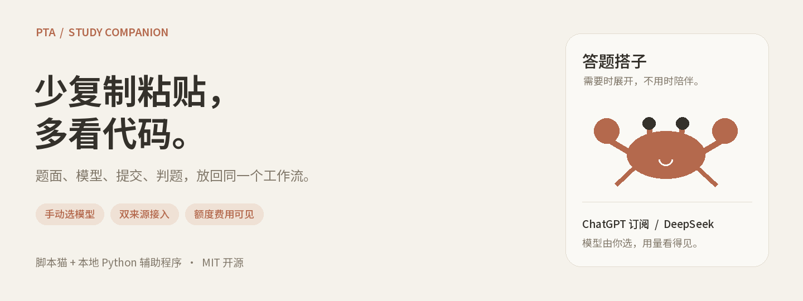
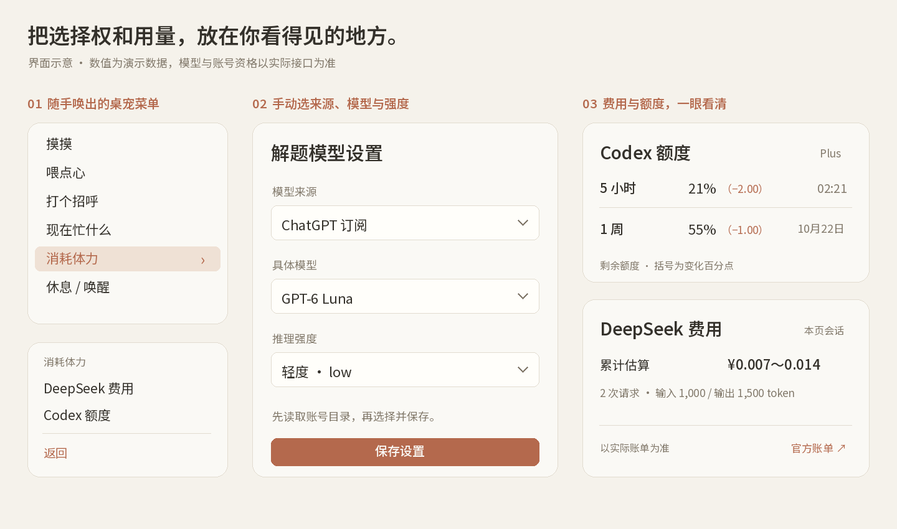

<p align="center">
  
</p>

<h1 align="center">PTA 答题搭子 · Study Companion</h1>
<p align="center"><strong>把题目、模型、代码和判题放回同一个工作流。</strong></p>
<p align="center">快速提交 / 模拟输入 · Claude 风格简约界面 · 像素桌宠互动 · MIT</p>
<p align="center">
  <a href="#开始使用">开始使用</a> ·
  <a href="#两种答题模式怎么选">两种模式</a> ·
  <a href="#先看界面">界面预览</a> ·
  <a href="docs/USAGE.md">完整教程</a> ·
  <a href="docs/CODEX_SETUP.md">Codex 从零配置</a> ·
  <a href="docs/TROUBLESHOOTING.md">常见问题</a>
</p>

## 遇到题目不会又得开窗口问AI？PTA不给复制只能人工手搓？

本项目解决了PTA禁止复制问题，提供快速答题和模拟输入两种方式，AI直接接管，2s一道题
题面在 PTA，模型在另一个窗口，代码要贴回编辑器，判题失败还得搬运错误信息。题目有附图、函数接口或多个填空时，漏一个细节，又得重来。

**答题搭子把这些步骤串起来：读取题面与附图 → 调用你选定的模型 → 写入或提交代码 → 查看判题并按设置修正。** 想减少页面操作，可以选快速提交；想在编辑器中看到代码录入过程，可以选模拟输入。收起面板后，Clawd 风格的橙色像素桌宠留在页面上，随时打开任务和用量信息。

## 两种答题模式，怎么选

**模式决定代码怎样交给 PTA；模型来源决定由谁生成代码。两者是独立的选择。**

| | 快速提交 | 模拟输入 |
| --- | --- | --- |
| 工作原理 | 读取题目数据和附图，生成代码后通过当前登录会话的 PTA 接口提交，再按提交 ID 查询判题回执 | 打开对应题目，把生成代码按 120 字符一段写入页面编辑器；每段读回一致后，点击 PTA 原生提交按钮并读取结果 |
| 你会看到 | 浮窗内的进度、提交状态、结果和代码；代码不必逐段出现在页面编辑器里 | 编辑器逐段出现代码，然后经过页面提交流程；它仍会自动提交，不是只帮你录入 |
| 适合场景 | 希望减少反复跳题、复制和点击，处理允许使用辅助工具的练习题集 | 希望检查写入过程，或需要沿用页面编辑器和原生提交流程； |
| 速度与依赖 | 减少编辑器写入和页面切换，但仍依赖模型响应、接口和判题速度 | 多了编辑器写入、读回及页面交互，通常更慢；依赖当前页面和编辑器结构 |
| 出错时 | 核对题目 ID、提交 ID 和实际判题；已有提交回执时优先恢复查询 | 题目切换、编辑器缺失或读回不一致就停止；未确认判题时先检查提交列表 |

```text
快速提交  读取题面与附图 → 所选模型 → PTA 接口提交 → 按提交 ID 查判题
模拟输入  读取题面与附图 → 所选模型 → 分段写入并读回 → 页面按钮提交 → 读结果
```

程序填空走专门的填空处理流程。两种模式都需要有效登录与平台允许的作答权限；模拟输入是浏览器编辑操作，不等于操作系统键盘模拟，也不保证规避平台限制。判题失败后的修正规则取决于所选模型来源，见下文。

| 你可能遇到的问题 | 答题搭子提供的操作 |
| --- | --- |
| 题面、图片、函数接口来回搬，容易遗漏 | 读取实际题目结构和附图；区分编程、函数和程序填空 |
| 想换模型，却不知道最后用了哪个 | 按「来源 → 具体模型 → 推理强度」手动选择；读取账号目录后再选 |
| 调用失败后反复重试，额度花得心里没底 | ChatGPT 路线顺序处理题集，自动修正次数可设，接口错误停止本轮 |
| 想知道还剩多少额度，而不是只看 token | 可选接入本机 Codex CLI，查询账号额度窗口与重置时间 |
| DeepSeek 用了多少，得来回翻账单 | 在桌宠里看本页费用估算、最近一次费用和用量，保留官方账单入口 |
| 悬浮窗一直挡着题目 | 收起为桌宠；拖动位置、调整面板尺寸，需要时再展开 |

## 先看界面



*图中为功能与布局示意，数字为演示数据；实际可选模型、额度窗口和费用由接口结果决定。暖米白背景、细边框和陶土色交互，让常用信息更容易扫读。*

**右键桌宠 → 消耗体力 → DeepSeek 费用 / Codex 额度。**

- **Codex 额度**：显示剩余百分比、括号中的变化和重置时间。括号单位为百分点；无可比较记录时显示「—」。变化是整个账号的变化。
- **DeepSeek 费用**：显示本页会话人民币估算区间；缺失用量或未核实单价时显示未知，不当作零费用。以服务商账单为准。

## Claude 风格的简约界面，和有反馈的互动

界面借鉴 Claude 的暖纸色、陶土橙和克制留白：正文保持清楚的层级，按钮只强调当前动作，费用与额度以短卡片呈现，详细解释按需展开。桌宠采用 **Clawd 风格的橙色像素造型**，配图直接复用用户脚本里的 SVG 轮廓，方块身体、短脚与像素眼睛保持一致。

| 操作 | 反馈与用途 |
| --- | --- |
| 单击桌宠 | 展开或收起答题面板，把阅读空间还给题面 |
| 拖动桌宠或标题栏 | 调整浮窗位置；可拖动边角或填写宽高，尺寸和位置会保存 |
| 移动指针、双击、摸摸或喂点心 | 视线跟随、跳动和短句回应；提供轻量陪伴，不改变判题结果 |
| 右键 → 现在忙什么 | 查看当前活动；等待模型或判题时按实际状态提示 |
| 右键 → 消耗体力 | 打开 Codex 额度或 DeepSeek 费用，不把 token 数量冒充账号剩余额度 |
| 休息 / 唤醒 | 改变桌宠外观；后台任务照常进行，停止作答要用“停止任务” |

任务进度区域保持固定空间，避免数字变化时浮窗反复跳动；系统开启减少动态效果时关闭主要动画。设计和桌宠是界面表达，**本项目没有接入 Claude 模型，也不代表 Anthropic 官方产品或授权背书**。

## 两种来源，你自己选

| 来源 | 工作原理 | 适用场景与准备 |
| --- | --- | --- |
| **DeepSeek API** | 用户脚本通过脚本管理器的网络接口，携带自己的 API Key 直接请求 DeepSeek，并记录返回的 usage | 希望使用独立 API 计费、关注每次请求与本页累计费用；需自己的 Key 和可用余额，答题主流程不需要 Python 辅助程序 |
| **Codex / ChatGPT 订阅授权** | 用户脚本把题面发给本机 Python 辅助程序；辅助程序通过用户自己的 OAuth 授权调用 Responses 接口，收到完整成功事件后返回代码 | 希望使用自己账号目录里的模型、手动选择推理强度；需要本地辅助程序、有效授权及服务端开放的相应能力；设置页名称为“ChatGPT 订阅” |

本项目通过 [Sign in with ChatGPT](https://developers.openai.com/siwc/token-sharing-open-source) 的本地应用授权路径接入，不分发账号或凭据。**开源软件不赠送额度，也不能让没有对应权限的账号获得权限。**

模型切换由用户发起：不会在 ChatGPT 失败时自动切到 DeepSeek，也不会暗中升级成更贵的模型。模型列表来自账号目录，不是写死的一串“可用模型”；默认选择仍需经过实际调用验证。

ChatGPT 路线消耗账号与应用的实际限额；DeepSeek 按服务商账单计费。**Codex CLI 在本项目中用于可选的账号额度查询，不负责这两条路线的答题生成。** 安装 CLI 不会自动把项目的模型目录、PTA 配对或第三方 API 配置好。

## 开始使用

### DeepSeek：简单配置，先从这里开始

**浏览器安装脚本猫 → 导入 `pta-luna.user.js` → 在设置中选 DeepSeek API → 填自己的 Key、选择模型并保存。** 先用一道练习题验证即可。只用 DeepSeek 答题不需要安装 Python、Node.js 或 Codex CLI；确保 Key、余额和网络可用。完整步骤见 [使用指南](docs/USAGE.md)。

### Codex / ChatGPT 订阅：本地授权与模型配置

**先准备：Windows、Python 3.10+、安装了脚本猫的浏览器，以及可连接服务商的网络。** 本地辅助程序的一键启动流程面向 Windows；其他系统的手动启动见 [完整教程](docs/USAGE.md)。

1. **下载并完整解压源码。** 在 GitHub 点击 `Code → Download ZIP`，解压到固定目录，不要在压缩包里运行。
2. **启动辅助程序。** 双击 `start-windows.cmd`，首次会创建独立 Python 环境并安装依赖。保持启动窗口开启。
3. **登录并验证。** 在自动打开的本机管理页用自己的 ChatGPT 账号授权，读取模型目录，再做一次最小测试。测试也会消耗额度。
4. **安装用户脚本。** 在脚本猫中导入 `pta-luna.user.js`。停用旧版，避免两个脚本同时操作页面。
5. **配对、选模型。** 在 PTA 页面打开「解题模型设置」，填入管理页的本机地址和配对码，点击「读取账号模型并检查连接」，选择具体模型与推理强度，保存。
6. **先试一题。** 检查题面、生成代码与判题结果，再决定是否处理整个题目集。

查询 **Codex 真实额度** 才额外需要已安装、已登录同一账号的 Codex CLI。CLI 不是答题主流程的必装项。

### 没装 Node.js、也没装 Codex CLI？

这两个问题在实际配置中都遇到过：只下载本项目，不会顺带安装它们。若要显示 Codex 额度，请按 [Windows 从零配置 Codex](docs/CODEX_SETUP.md) 完成 **Node.js LTS → npm → Codex CLI → 同账号登录 → 重启辅助程序 → 查询验证**。教程给出每步命令、成功标志和失败后的检查点；只用 DeepSeek 答题可跳过这条安装路线。


## 该停的时候，停得下来

ChatGPT 路线默认每题最多自动修正 3 次，可设为 0～10 次；题集按顺序处理。额度、权限、网络或响应格式异常会停止本轮，并暂停新推理请求；处理问题后需要手动恢复。

这套限制**不等于零成本保证**。已经开始的请求、取消和断流仍可能产生用量。DeepSeek 路线保留原有重试规则，部分错误可能持续重试，应留意任务状态并主动停止。两条路线都不保证答案正确或通过判题。

## 你的账号，留在你的电脑上

- 辅助程序只监听 `127.0.0.1`，管理口令和脚本配对码分离。
- ChatGPT OAuth 凭据保存在本机；Windows 使用当前用户 DPAPI 保护，不交给 PTA 页面或用户脚本。
- 额度查询使用本机 Codex app-server 的只读账号方法，不读取或导出 Codex 登录文件。
- 题面、附图、代码和错误上下文会发给**你选择的模型服务商**，不会因为本地辅助程序而变成完全离线处理。
- DeepSeek Key 可选择记住在脚本管理器中；共享电脑上请谨慎开启。

见 [安全与隐私说明](SECURITY.md)。本项目不是 OpenAI、DeepSeek、PTA 或脚本猫的官方产品；界面采用暖色简洁设计，不代表与 Anthropic/Claude 存在关联。

## 文档与开发

| 我想…… | 去这里 |
| --- | --- |
| 从零配置、手动启动、切换模型 | [使用指南](docs/USAGE.md) |
| 还没安装 Node.js / Codex CLI，想从零配置额度查询 | [Codex 配置教程](docs/CODEX_SETUP.md) |
| 解决找不到 CLI、端口占用、模型列表只有一个 | [排查指南](docs/TROUBLESHOOTING.md) |
| 看版本与验证边界 | [更新记录](CHANGELOG.md) |
| 修改代码、提交问题、运行测试 | [贡献指南](CONTRIBUTING.md) |
| 看代码来源和第三方许可 | [第三方声明](THIRD_PARTY_NOTICES.md) |

本地验证包含 **63 项 Python 测试 + 26 项 JavaScript 测试**，覆盖协议处理、授权校验、取消任务、额度读取、费用估算与部分 DOM 行为。模拟接口测试不等于所有账号、所有模型和所有 PTA 页面都经过实测。

欢迎带着可复现步骤提 Issue；分享日志前请遮盖凭据、邮箱、配对码和管理页带口令的 URL。请遵守课程、考试和平台规则，在允许使用辅助工具的练习场景中使用。

## 许可证与致谢

本项目采用 [MIT License](LICENSE)。源码中包含的 MIT 第三方版权声明原样保留，详见 [第三方声明](THIRD_PARTY_NOTICES.md)。
